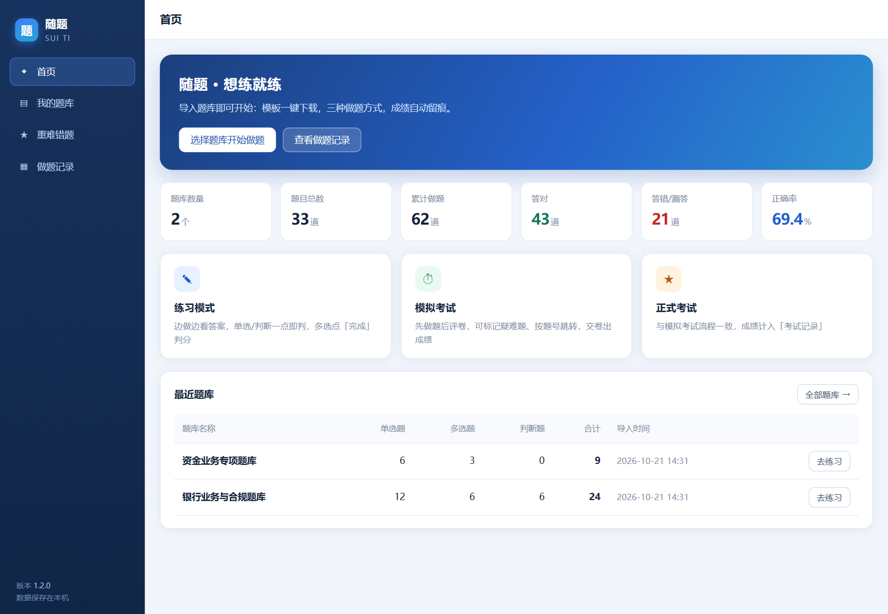
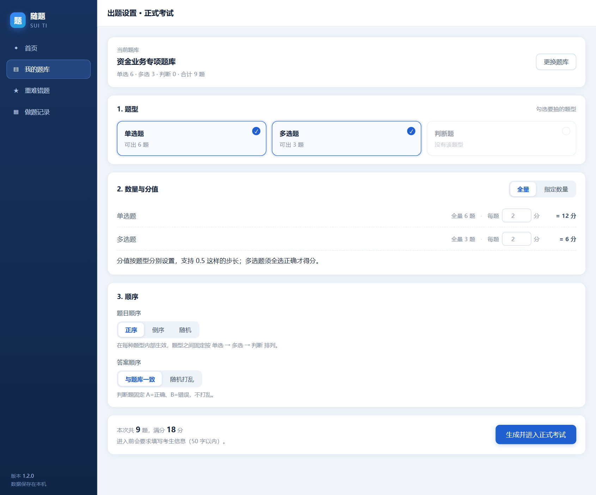
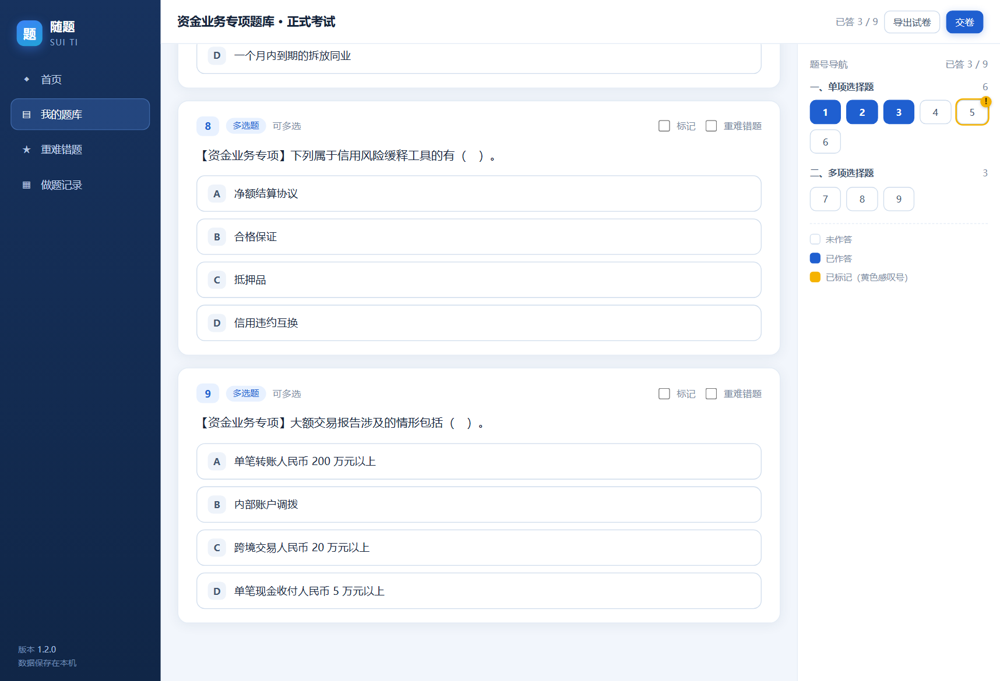
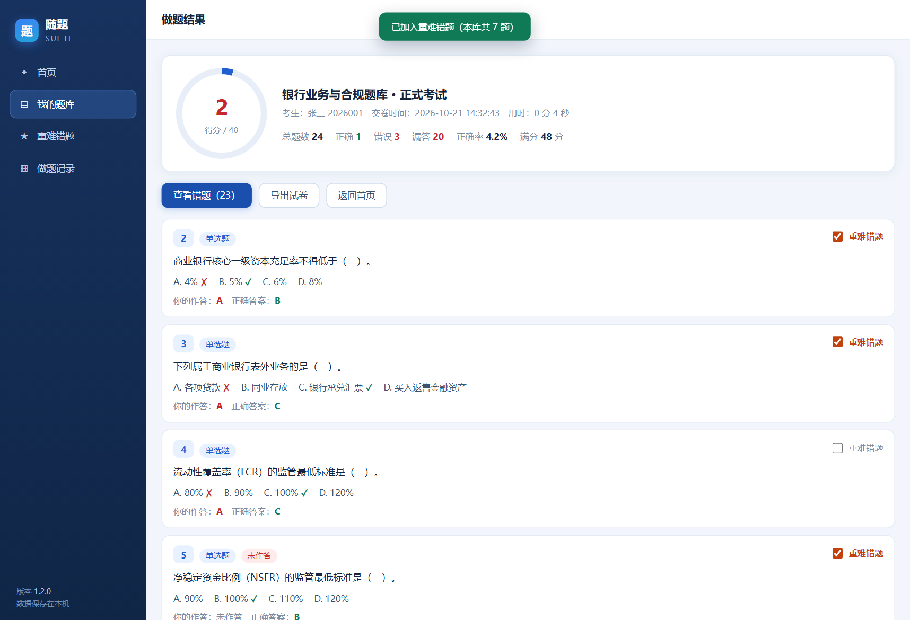
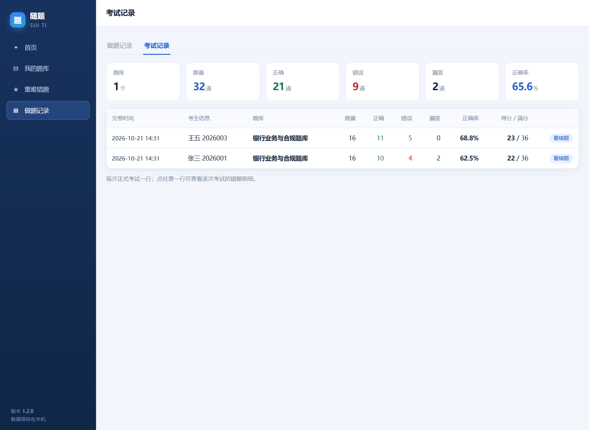
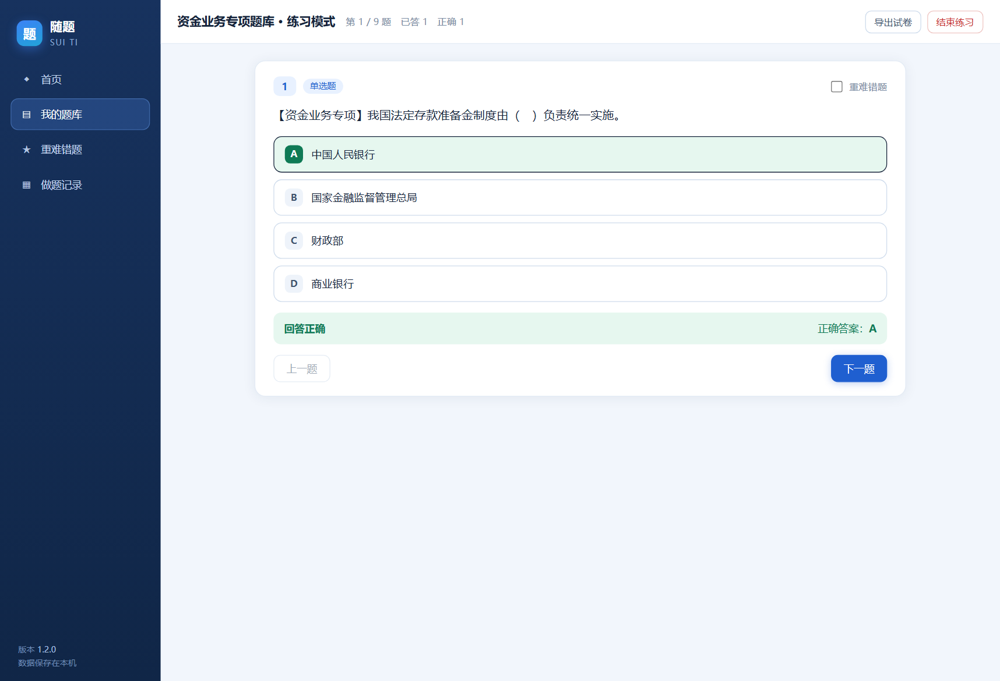
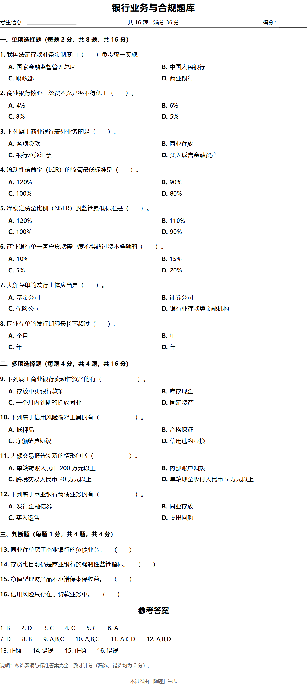
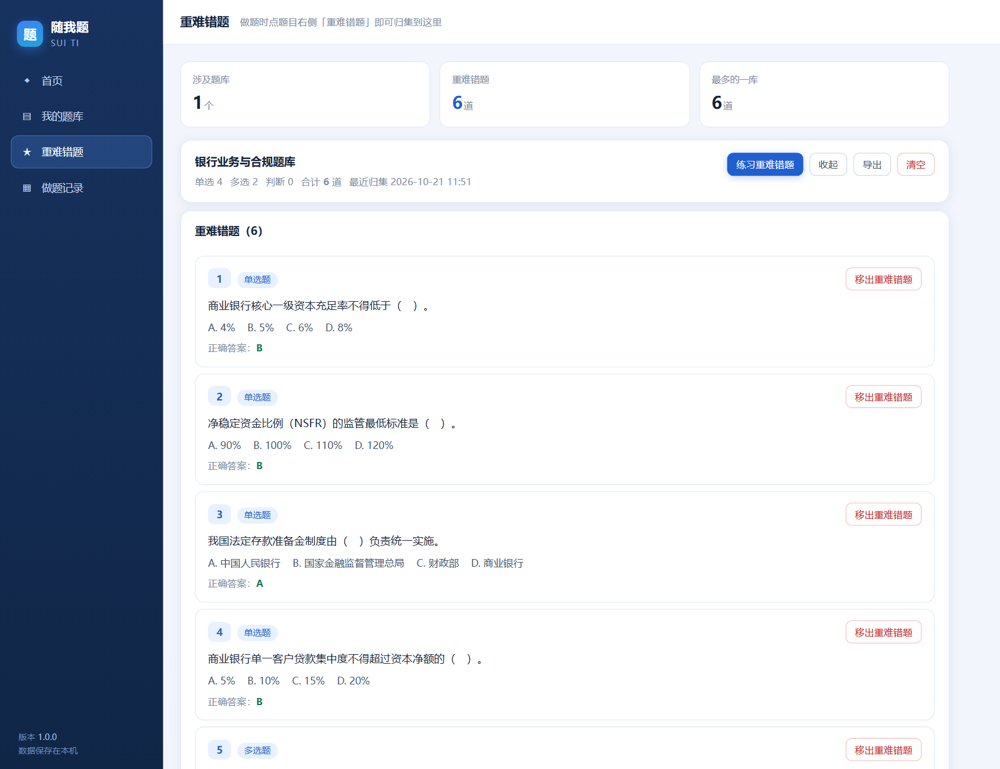
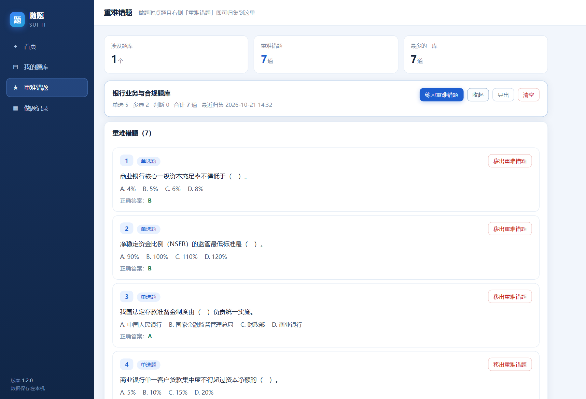

# 随题 · 桌面做题程序

一个完全离线的单机做题程序：导入 Excel 题库 → 练习 / 模拟考试 / 正式考试 → 自动评卷 → 记录留痕 → 导出 PDF / Word / Excel。

- 运行环境：Windows 10 / 11（64 位），无需安装 Python、无需联网。
- 程序本体：`随题.exe`（单文件，约 19 MB），双击即用。
- 数据全部保存在本机，不上传任何地方。

## 界面预览

| | |
|---|---|
|  |  |
|  |  |
|  |  |
|  |  |
|  |  |

---

## 一、三步开始

1. **下载模板**：进入「我的题库」→「下载导入模板」，得到一个 `.xlsx`。
2. **填题库**：按模板里的「填写说明」填题，一行一题。填完保存。
3. **导入题库**：回到「我的题库」→「导入题库文件」→ 选中文件。导入成功后即可开始做题。

> 导入时如果一个文件里有任何一行填错，整个文件都不会入库，并会告出具体行号与原因 —— 这样不会出现"导进去一半"的糊涂账。

### 模板字段（「题库」工作表）

| 列 | 说明 |
|---|---|
| 题型 | `单选` / `多选` / `判断`（也接受「单选题」「多项选择题」等写法） |
| 题干 | 题目正文，必填 |
| 选项 | **写法一（推荐，选项数量不限）**：多个选项用竖线 `|` 或 `Alt+Enter` 换行分隔，例如 `人民币\|美元\|欧元` |
| 选项A ~ 选项H | **写法二（最直观，最多 8 个）**：每列填一个选项 |
| 正确答案 | 单选填 `A`；多选填 `ABD` 或 `A,B,D`；判断填 `正确` / `错误` |

- 「选项」列与「选项A~H」同时填时，只认「选项」列。
- 判断题不用填选项，程序自动按「正确 / 错误」两选项处理；答案也接受 `对`、`错`、`√`、`×`、`T`、`F`、`是`、`否`、`A`、`B`。
- 答案也可以直接写选项的完整文字，程序会按文本匹配。
- 选项前带 `A.` `A、` `（1）` 这类序号会自动去掉。
- 只支持 `.xlsx`；`.xls` 老格式请在 Excel 里「另存为」`.xlsx`。

---

## 二、三种做题方式

进入某个题库后点「练习 / 模拟 / 正式考试」，都会先到**出题设置页**：

- **题型**：勾选要抽的题型（题库里没有的题型不可选）。
- **数量与分值**（同一区块）：
  - 数量：全量，或按题型分别填数字；
  - 分值：**单选、多选、判断可以分别设不同分值**（支持 2.5 这类小数），每行右侧实时显示该题型小计「= N 分」，页面底部汇总「共 N 题，满分 M 分」。
- **题目顺序**：正序 / 倒序 / 随机 —— 在**每种题型内部**生效，题型之间固定按 单选 → 多选 → 判断 排列。
- **答案顺序**：与题库一致 / 随机打乱 —— 判断题固定 `A=正确`、`B=错误`，不打乱。
- 页面底部实时显示「本次共 N 题，满分 M 分」。

点「生成并进入」后：

| 模式 | 考生信息 | 判分时机 | 计入记录 |
|---|---|---|---|
| 练习模式 | 不需要 | 每题作答后立即判分，显示正确答案 | 做题记录 |
| 模拟考试 | 需要（≤50 字） | 交卷时统一评卷 | 做题记录（不计入考试记录） |
| 正式考试 | 需要（≤50 字） | 交卷时统一评卷 | 做题记录 + **考试记录** |

### 练习模式
单选、判断**点选即判**；多选要先勾若干项，再点「完成」才判分。判过的题会锁定并标出正确项，可回看但不能再改。

### 模拟考试 / 正式考试
- 每道题右上角有「标记」勾选框，可随时勾选/取消。
- 右侧题号面板按题型分组：**白色 = 未作答，蓝色 = 已作答，右上角黄色感叹号 = 已标记**。
- 单击或双击题号，卷面会自动滚到对应题目。
- 点「交卷」会先给出「已答 / 未答 / 已标记」汇总，确认后自动评卷。

### 交卷结果
分数、总题数、正确、错误、漏答、正确率，并可「查看错题」逐题对照「你的作答 / 正确答案」。

---

## 三、导出

练习、模拟考试、正式考试三个页面顶部都有「导出试卷」，可保存为 **PDF / Word / Excel**：

- 内容 = 试题正文 + **卷末参考答案页**；**卷面不打印日期**。
- **卷面标题固定为该题库的名称**，不缀「练习 / 模拟考试 / 正式考试」这类字样 —— 同一个题库无论用哪种方式做题、导出的卷子抬头都一样。
- **卷头固定四项，排在同一行**：左边「考生信息」、中间「共 N 题　满分 M 分」、右边「得分」。练习卷同样保留考生信息栏（没填考生信息就留一条空白下划线，方便手写）。
- 大题标题按该题型分值显示「每题 X 分，共 N 题，共 M 分」，不同题型分值不同也能正确显示；「重难错题」导出的卷子没有分值概念，卷头只给题量、考生信息、得分。
- 默认文件名同样只用题库名 + 时间戳（有考生信息时再带上考生信息），不含练习/考试字样。
- **题干答题括号**（仅 PDF / Word）：导出时逐题检查题干——
  - 题干里已有空括号（`（　）`、`( )` 这类）就按题型把里面的间隙统一：**单选、判断留 2 个字符，多选留 6 个字符**；
  - 题干里一个空括号都没有，就在题干末尾补一个（间隙同样按题型）；
  - 括号里本来就有文字的（例如「（2015 年修订）」）一律不动，另外在末尾补一个空括号，保证每题都有作答位置。
  - Excel 导出保持题库原样，不自动加括号。
- 模拟/正式考试**未交卷时导出会二次确认** —— 因为文件里带答案，别在考试中发给考生。
- PDF 由本机 Microsoft Edge 打印生成，中文排版最稳；若 Edge 不可用，会自动改用 Word 转 PDF，仍失败则提示先导出 Word 再另存为 PDF。
- 导出文件默认落在 `%APPDATA%\SuiTi\exports\`，保存时会弹系统对话框，可另选位置。
- 导出内容取自交卷时的快照，题库以后被修改或删除都不影响已导出的卷子。

---

## 四、重难错题

做题时，**每道题右侧都有一个「重难错题」勾选框**（练习模式、模拟考试、正式考试、交卷后的「查看错题」里都有）。勾上就会把这道题收进左侧菜单的「重难错题」模块，并按题库归类。

进入「重难错题」页：

- 上方按题库汇总：涉及几个题库、共多少道重难错题；
- 每个题库一行，可 **练习重难错题**（进入出题设置，题源只有该题库重难错题，同样可以选数量、分值、顺序）、**查看题目**（展开逐题看题干、选项、正确答案，可逐题「移出重难错题」）、**导出**（把该题库全部重难错题导成 PDF / Word / Excel，含卷末答案页）、**清空**。
- 在重难错题的练习页里，把题目上的勾去掉就等于「移出重难错题」。
- **删除题库时，它在重难错题里的归集也会一并删除**（用户要求），避免留下无主的题。

重难错题是"归集清单"，不影响题库本身，也不影响已有的做题记录与成绩。

## 五、记录

「做题记录」页两个页签：

- **做题记录**（练习 + 模拟 + 正式）：顶部为整体情况 —— 题库数量、做题数量、正确、错误、漏答、正确率；下方按题库逐行列出同样指标。
- **考试记录**（只有正式考试）：顶部为整体情况 —— 题库、题量、正确、错误、漏答、正确率；下方**每次正式考试一行**，含交卷时间、考生信息、题库、题量、正确/错误/漏答、正确率、得分，点任意一行可看该次错题明细。

统计口径（写死，避免歧义）：

- **做题数量** = 已判定对错的题数（练习与考试累加）。
- **漏答** = 只在模拟/正式考试中统计：交卷时仍未作答的题。练习模式不产生漏答。
- **正确率** = 正确 ÷ 做题数量（考试记录页为 正确 ÷ 题量）。
- 中途关掉未交卷：已作答并判过的题仍计入做题记录；关窗时若还有未交卷的卷子，会二次确认。

---

## 六、数据在哪、怎么备份

```
%APPDATA%\SuiTi\
  suiti.db      ← 题库、题目、做题记录、考试成绩（SQLite）
  app.log       ← 运行日志（排查问题用）
  exports\      ← 导出的试卷
```

在资源管理器地址栏粘贴 `%APPDATA%\SuiTi` 即可打开。

- **备份/换机**：关掉程序，把整个 `SuiTi` 文件夹拷走即可；换机器时连同 `随题.exe` 一起拷过去。
- **清空重来**：关掉程序，删除 `suiti.db`（记录与题库都会清空）。

---

## 七、常见问题

**1. 双击没反应 / 被安全软件拦截**
程序是 PyInstaller 打包的绿色单文件，部分安全软件会误报。请把 `随题.exe` 加入白名单。首次启动要解包，约 3～8 秒出窗口属正常。

**2. 提示「未找到 Microsoft Edge，无法生成 PDF」**
仍可导出 Word / Excel；或用本机 Word 打开导出的 .docx 后「另存为 PDF」。Windows 10/11 一般自带 Edge，若被卸载请重装。

**3. 导入报错「答案字母超出选项范围」**
答案写到了不存在的选项，比如只有 4 个选项却填了 `E`。按提示的行号改掉再导入。

**4. 导入报错「找不到表头行」**
请用「下载导入模板」生成的表格填写，并且不要改动第一行表头、不要把数据写到别的工作表（程序优先读名为「题库」的工作表）。

**5. 同一个题库名重复导入会怎样**
自动改名为「原名 (2)」，不会覆盖之前的题库。

**6. 题库删了，以前的成绩还在吗**
在。记录保存的是当时的题目快照与统计结果，与题库是否还在无关。

---

## 八、给维护者

```
app/                运行时代码（Python）
  main.py           入口：日志、单实例、建窗、关窗保护
  api.py            暴露给前端的接口（统一 {"ok":..,"data":..} 信封）
  services/         判题、导入、会话、统计、导出
  gui/              前端（原生 HTML/CSS/JS，无构建步骤）
build/              SuiTi.spec、build.ps1、图标生成、版本信息
tests/run_check.py  后端端到端自检（含三格式导出）
tests/seed_dev.py   造开发用题库与记录（写在 .devdata，不碰真实数据）
tools/              playwright 截图 / 交互回归脚本
run_dev_server.py   开发预览服务（浏览器里跑真实后端）
```

**重建 exe**：

```powershell
powershell -ExecutionPolicy Bypass -File build\build.ps1
```

**跑后端自检**（会检查模板、导入、打乱、判题、记录、三格式导出，共 67 项）：

```powershell
.venv-build\Scripts\python.exe tests\run_check.py
```

**界面预览 / 交互回归**（需要先起开发服务）：

```powershell
$env:APPDATA="$PWD\.devdata"; .venv-build\Scripts\python.exe run_dev_server.py 8765
node tools\shot_pages.js      # 逐页截图
node tools\flow_test.js       # 出题→考生信息→作答→标记→交卷→结果→导出→模拟考试 全流程
```
